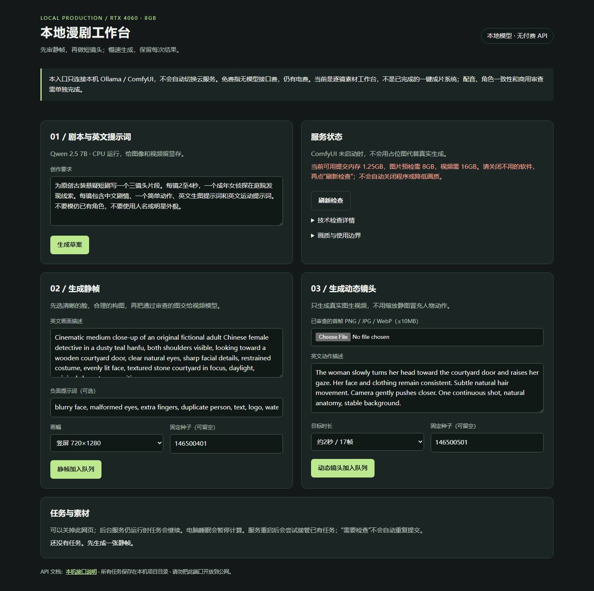
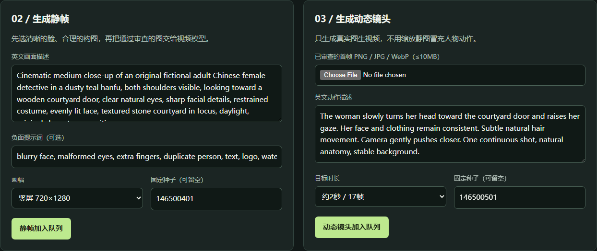

<h1 align="center">
  AIvideo
</h1>

<p align="center">
  <strong>Local AI Comic-Drama Workbench</strong><br/>
  <a href="./README.md">中文</a> · English
</p>

<p align="center">
  
  
  
  
</p>

Open-source **local generation gateway** for Windows + NVIDIA (Apache-2.0): Ollama drafts text, ComfyUI makes stills and short I2V clips, humans review and edit. Optional Toonflow 2.x custom media provider.

**Repo:** https://gitee.com/withthesea/ai-diy-video · Mirror: https://github.com/qinfendeyuyu/AIvideo  
**Baseline:** [`docs/EVALUATION.md`](docs/EVALUATION.md) (protocol tests are reproducible; **not** a commercial-quality short-drama claim).

## Engineering facts

| Item | Fact |
|:---|:---|
| Code | ~15k Python LOC across `app/` · `scripts/` · `tests/` |
| Tests | 82+ pytest + 13 Node provider contract cases (2026-10-08) |
| Runtime | Gateway `:18766` · Ollama `:11434` · ComfyUI `:8488` (same machine) |
| Release | Engineering baseline `0.2.0` |

## Why AIvideo

| Typical expectation | This project |
|:---|:---|
| One-click premium drama | Shot-by-shot: draft → still review → 2–4s I2V → review |
| Silent retries on failure | Unknown submit → `needs_attention`, queue pauses |
| Force-run when RAM is low | Windows commit-memory gate returns 503 |
| Fake “success” without models | `/health` reports gaps; no forged assets |

## Screenshots

| Workbench | Generation panels |
|:---:|:---:|
|  |  |

Walkthrough GIF (real 503 on low memory): [`docs/screenshots/generation-walkthrough.gif`](docs/screenshots/generation-walkthrough.gif)

## Local samples

**Wan 30s quality preview** — 6 chained I2V shots (480×832 · 16fps · RTX 4060 8GB), concat **18.4s**.

<p align="center">
  <a href="https://gitee.com/withthesea/ai-diy-video/blob/main/docs/samples/wan_30s_preview/preview_concat.mp4"></a><br/>
  <a href="https://gitee.com/withthesea/ai-diy-video/blob/main/docs/samples/wan_30s_preview/preview_concat.mp4"><strong>▶ Watch full concat (18.4s)</strong></a>
</p>

Engineering preview only — not a commercial-quality claim. Details: [docs/SAMPLES.md](docs/SAMPLES.md)

## Quick start

```powershell
git clone https://gitee.com/withthesea/ai-diy-video.git
cd ai-diy-video
py -3.12 -m venv .venv
.\.venv\Scripts\python.exe -m pip install -r requirements.txt
# Prepare Ollama qwen2.5:7b + ComfyUI with models (see docs/PUBLIC_DEPLOYMENT.md)
.\scripts\start_local_free.ps1 -CheckOnly
.\scripts\start_local_free.ps1 -Background
```

Open http://127.0.0.1:18766/

## Stack

Python 3.12 · FastAPI · Ollama · ComfyUI · RealVisXL V5 · Wan2.1 I2V 14B FP8 · FFmpeg · optional Toonflow provider

## License

Apache-2.0 · See [LICENSE](./LICENSE) · Full Chinese docs in [README.md](./README.md) · Third-party / model rights in [docs/THIRD_PARTY_NOTICES.md](docs/THIRD_PARTY_NOTICES.md)
