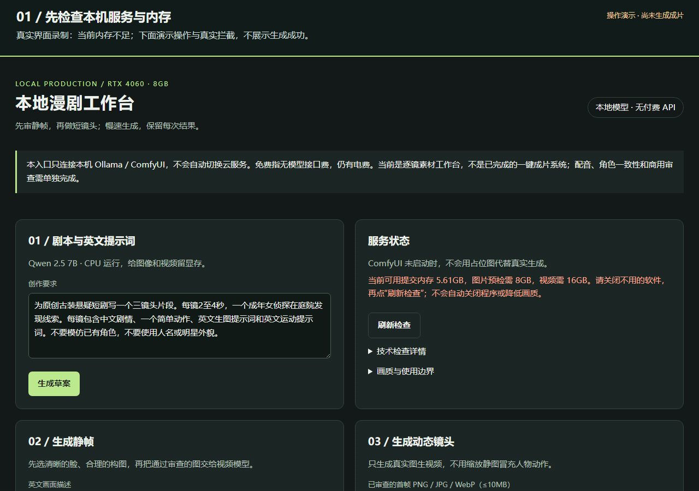
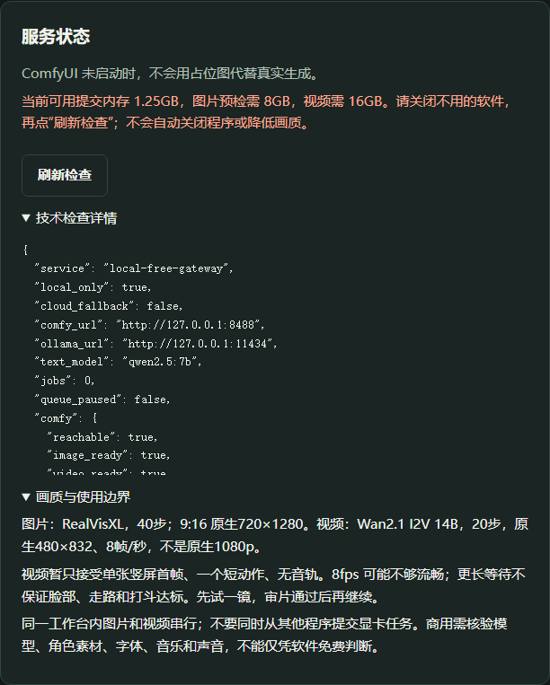
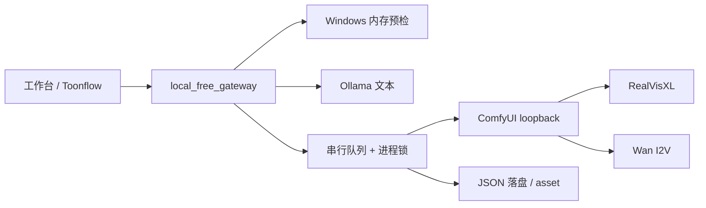

<h1 align="center">
  AIvideo · 免费本地 AI 漫剧工作台
</h1>

<p align="center">
  <strong>Local AI Comic-Drama Workbench</strong><br/>
  中文 · <a href="./README.en.md">English</a>
</p>

<p align="center">
  
  
  
  
  
  <a href="https://gitee.com/withthesea/ai-diy-video"></a>
</p>

<p align="center">
  <a href="https://gitee.com/withthesea/ai-diy-video"><strong>https://gitee.com/withthesea/ai-diy-video</strong></a><br/>
  <sub>Apache-2.0 · 引用 / 二次分发请以 Gitee 为主入口（GitHub 镜像：<a href="https://github.com/qinfendeyuyu/AIvideo">qinfendeyuyu/AIvideo</a>）</sub>
</p>

---

面向 **Windows + NVIDIA** 的本地 AI 漫剧实验工程：Ollama 写草案、ComfyUI 出静帧与短动态镜头，再由人审片、剪辑。可选接入 Toonflow 2.x 自定义媒体供应商。

> **一句话**：可运行的本机生成网关与逐镜工作台——队列可恢复、内存会拒绝、不假装一键精品短剧。

### 工程基线（可核对，不靠口号）

| 项 | 事实 |
|:---|:---|
| 代码 | 仓库 Python ≈ 1.5 万行（`app/` · `scripts/` · `tests/`）；网关为当前正式入口 |
| 测试 | 2026-10-08：`pytest` **82** 项 + Toonflow 供应商 Node 协议 **13** 组通过 |
| 运行时 | 网关 `127.0.0.1:18766` · Ollama `:11434` · ComfyUI `:8488`（须同机） |
| 交付物 | 中英 README · 本地 Wan 样片 6 镜 · 截图/操作动图 · Apache-2.0 |
| 诚实边界 | **尚未**完成干净新机 GPU 端到端复现，也**未**做与商用样片同等画质验收 |

| 常见期望 | 本项目实际 |
|:---|:---|
| 一键生成精品短剧 | 逐镜：草案 → 静帧人审 → 2–4 秒 I2V → 再人审 |
| 失败就静默重试 | 未知提交结果进 `needs_attention`，停队列等人核对 |
| 内存不够硬跑 | Windows 提交内存预检不足直接 503，不改页面文件 |
| 缺模型也能“跑通” | `/health` 标出缺失；不伪造进度、素材或成功态 |

“免费”= 不调用按次收费模型 API；仍有硬件、电费、存储与人工成本。模型权重不随仓库分发。

---

## 本地生成样片

**司天署·30 秒画质试片**（Wan2.1 I2V 14B FP8 · 480×832 · 16fps · RTX 4060 8GB）。6 镜顺序拼接，总长 **18.4s**。

<p align="center">
  <a href="https://gitee.com/withthesea/ai-diy-video/blob/main/docs/samples/wan_30s_preview/preview_concat.mp4"></a><br/>
  <a href="https://gitee.com/withthesea/ai-diy-video/blob/main/docs/samples/wan_30s_preview/preview_concat.mp4"><strong>▶ 观看完整拼接预览（18.4s）</strong></a><br/>
  <sub>
    <a href="docs/samples/wan_30s_preview/preview_concat.mp4">仓库相对路径</a> ·
    <a href="https://gitee.com/withthesea/ai-diy-video/raw/main/docs/samples/wan_30s_preview/preview_concat.mp4">Raw 下载</a>
  </sub>
</p>

| 镜头 | 说明 | 在线打开 |
|:---|:---|:---|
| P01 | 睁眼 | [▶ 00_P01.mp4](https://gitee.com/withthesea/ai-diy-video/blob/main/docs/samples/wan_30s_preview/clips/00_P01.mp4) |
| P02 | 侧耳 | [▶ 01_P02.mp4](https://gitee.com/withthesea/ai-diy-video/blob/main/docs/samples/wan_30s_preview/clips/01_P02.mp4) |
| P03 | 侍从急报 | [▶ 02_P03.mp4](https://gitee.com/withthesea/ai-diy-video/blob/main/docs/samples/wan_30s_preview/clips/02_P03.mp4) |
| P04 | 应答 | [▶ 03_P04.mp4](https://gitee.com/withthesea/ai-diy-video/blob/main/docs/samples/wan_30s_preview/clips/03_P04.mp4) |
| P05 | 起身 | [▶ 04_P05.mp4](https://gitee.com/withthesea/ai-diy-video/blob/main/docs/samples/wan_30s_preview/clips/04_P05.mp4) |
| P06 | 城门异光 | [▶ 05_P06.mp4](https://gitee.com/withthesea/ai-diy-video/blob/main/docs/samples/wan_30s_preview/clips/05_P06.mp4) |

| P01 睁眼 | P03 侍从急报 | P06 城门异光 |
|:---:|:---:|:---:|
| [](https://gitee.com/withthesea/ai-diy-video/blob/main/docs/samples/wan_30s_preview/clips/00_P01.mp4) | [](https://gitee.com/withthesea/ai-diy-video/blob/main/docs/samples/wan_30s_preview/clips/02_P03.mp4) | [](https://gitee.com/withthesea/ai-diy-video/blob/main/docs/samples/wan_30s_preview/clips/05_P06.mp4) |

> **工程预览，不是商用验收**：P01–P03 约 5s/镜，P04–P06 约 1s/镜（参数不一致）；P04–P05 为远程 harvest 后同步。仅证明本机链路能出片，不承诺干净新机复现或参考样片同等画质。分镜元数据见 [docs/SAMPLES.md](docs/SAMPLES.md)。

---

## 界面预览

约 27 秒操作动图（填写参数 → 提交静帧 → 真实内存拦截 → 设置视频首帧）：

<p align="center">
  
</p>

> **操作教程，不是成功样片**：录制时内存不足，静帧真实返回 HTTP 503；未伪造进度或成片。说明见 [GENERATION_WALKTHROUGH.md](docs/GENERATION_WALKTHROUGH.md)。

| 工作台总览 | 静帧 / 动态入口 |
|:---:|:---:|
|  |  |
| **服务预检** | |
|  | |

截图来源与重拍：[docs/SCREENSHOTS.md](docs/SCREENSHOTS.md)。

---

## 技术栈

| 层 | 技术 |
|:---|:---|
| 网关 | Python 3.12 · FastAPI · Pydantic · httpx · Pillow |
| 文本 | Ollama · `qwen2.5:7b`（强制 CPU、生成后卸载） |
| 图像 / 视频 | ComfyUI · RealVisXL V5 · Wan2.1 I2V 14B FP8（WanVideoWrapper） |
| 校验 | FFmpeg / FFprobe（尺寸、帧率、完整解码） |
| 可选接入 | Toonflow 2.x 自定义供应商 `integrations/toonflow/localFreeV2.ts` |
| 部署 | PowerShell 启动器 · 仅 loopback（不提供公网方案） |

---

## 能力图谱

```text
┌─────────────┐   ┌──────────────────┐   ┌─────────────────┐
│ Ollama 文本 │ → │ RealVisXL 静帧   │ → │ Wan2.1 I2V 短片 │
│ 草案/提示词 │   │ 人审眼睛手脚服装 │   │ 单首帧 · 无音轨 │
└─────────────┘   └──────────────────┘   └─────────────────┘
        │                    │                      │
        └──────────┬─────────┴──────────┬───────────┘
                   ▼                    ▼
            持久化队列 / 进程锁     素材下载 · 人工剪辑
```

| 环节 | 本地后端 | 实际输出 / 约束 |
|:---|:---|:---|
| 剧本与提示词 | Ollama `qwen2.5:7b` | CPU · 4096 上下文 · ≤2048 token · 需人改 |
| 文生图 | RealVisXL V5 / ComfyUI | 40 步；720×1280 / 1280×720 / 1024×1024 |
| 图生视频 | Wan2.1 I2V 14B FP8 | 20 步 · 37 层 swap；480×832 · 8fps · 17/25/33 帧 |
| 任务记录 | 本地 JSON + 文件 | 种子、工作流、模型名、Comfy prompt ID、错误 |
| Toonflow | 自定义 TS 供应商 | `generateImage` / `generateVideo`；无需 API Key |

视频选项「2/3/4 秒」是采样跨度，编码后常为 2.125 / 3.125 / 4.125 秒。480×832 是近似竖屏，不是原生 1080p。算法细节：[docs/ALGORITHMS_AND_MODELS.md](docs/ALGORITHMS_AND_MODELS.md)。

---

## 系统架构

```text
scripts/local_free_gateway.py   正式免费网关（18766）
app/                            工作台静态页 + 历史实验流水线（非新网关）
workflows/                      ComfyUI API 工作流模板
integrations/toonflow/          Toonflow 媒体供应商
runtime_cache/                  任务与素材（Git 忽略）
tests/                          无模型协议 / 状态机测试
```



`app/main.py` 是旧实验流水线入口，不是新免费网关。

---

## 快速开始

### 1. 前置（须自行准备，不随仓库分发）

| 组件 | 要求 |
|:---|:---|
| Windows + PowerShell 7 | 正式入口仅 Windows（内存预检依赖 `GlobalMemoryStatusEx`） |
| Python 3.12 | 验证环境 3.12.5；根目录独立 `.venv` |
| FFmpeg | `ffmpeg` / `ffprobe` 在 PATH |
| Ollama | `:11434`，已 `ollama pull qwen2.5:7b` |
| ComfyUI | `:8488`，能跑仓库内工作流；模型与节点见下表 |
| 可用提交内存 | 文本 ≥6GiB · 图 ≥8GiB · 视频 ≥16GiB（非标称总内存） |

**ComfyUI 模型 / 节点（摘要）**

| 文件 / 组件 | 位置或用途 |
|:---|:---|
| `RealVisXL_V5.0_fp16.safetensors` | `models/checkpoints/` |
| `Wan2_1-I2V-14B-480p_fp8_e4m3fn_scaled_KJ.safetensors` | `models/diffusion_models/` |
| `umt5-xxl-enc-fp8_e4m3fn.safetensors` | `models/text_encoders/` |
| `open-clip-xlm-roberta-large-vit-huge-14_visual_fp16.safetensors` | `models/clip_vision/` |
| `wan_2.1_vae.safetensors` | `models/vae/` |
| ComfyUI-WanVideoWrapper · VideoHelperSuite | I2V 与 H.264 导出 |

完整复现限制（含开发机未打包补丁）：[docs/PUBLIC_DEPLOYMENT.md](docs/PUBLIC_DEPLOYMENT.md)。

### 2. 安装网关并启动

```powershell
git clone https://gitee.com/withthesea/ai-diy-video.git
cd ai-diy-video
py -3.12 -m venv .venv
.\.venv\Scripts\python.exe -m pip install -r requirements.txt

ollama pull qwen2.5:7b   # 若尚未安装
# 另开终端：按 PUBLIC_DEPLOYMENT.md 启动本机 ComfyUI :8488

.\scripts\start_local_free.ps1 -CheckOnly
.\scripts\start_local_free.ps1 -Background
```

打开 **http://127.0.0.1:18766/** 。交互文档：`/docs`。

> `-StartComfy` 仅原开发机路径；公开部署**不要**使用。不要用改页面文件 / 提权脚本绕过预检。

### 3. 逐镜制作

1. 写草案 → 一镜一动作  
2. 静帧人审（眼、嘴、手、服装）  
3. 合格首帧再做 2–4 秒短片  
4. 播首/中/尾帧；不合格保留为测试结果，不以「返回了 MP4」代替验收  

---

## API 与任务恢复

| 方法 | 路径 | 用途 |
|:---|:---|:---|
| GET | `/health` | 节点、模型、队列、内存 |
| POST | `/text` | 本机 CPU 文本 |
| POST | `/jobs/image` | 文生图入队 → 202 |
| POST | `/jobs/video` | 单首帧 I2V 入队 |
| GET | `/jobs` · `/jobs/{id}` | 列表 / 状态 |
| GET | `/jobs/{id}/asset` | 下载 PNG/MP4 |

任务目录：`runtime_cache/local_free_jobs/`。已知 Comfy prompt ID 可重启接管；提交确认丢失或状态损坏 → `needs_attention`，**无**一键盲重试。

---

## 测试

不占 GPU 即可验证协议与状态机：

```powershell
.\.venv\Scripts\python.exe -m pytest -q
node --experimental-vm-modules .\tests\test_toonflow_provider_contract.mjs
```

协议通过 ≠ GPU 样片通过 ≠ 商用画质。临时目录权限问题时可用 `--basetemp .pytest-temp-run-001`（勿指向真实素材目录）。

---

## 文档

| 文档 | 说明 |
|:---|:---|
| [项目简介](docs/项目简介.md) | 背景、能力与边界 |
| [公开部署](docs/PUBLIC_DEPLOYMENT.md) | 新机安装与复现限制 |
| [算法与模型](docs/ALGORITHMS_AND_MODELS.md) | 模型原理与代码对应 |
| [评测与诚实边界](docs/EVALUATION.md) | 测了什么、没测什么 |
| [路线图](docs/ROADMAP.md) | 已交付 / 待办 / 不做 |
| [本地样片](docs/SAMPLES.md) | Wan 试片来源与边界 |
| [截图说明](docs/SCREENSHOTS.md) · [操作动图](docs/GENERATION_WALKTHROUGH.md) | 界面素材来源 |
| [第三方许可](docs/THIRD_PARTY_NOTICES.md) | 模型与依赖权利 |
| [贡献指南](CONTRIBUTING.md) · [贡献者](CONTRIBUTORS.md) · [安全披露](SECURITY.md) | 社区 |

---

## 常见问题

**服务都起了，为何 `ready=false`？**  
看 `memory`、`comfy.*_missing`、`ollama.model_available`。32GB 总内存 ≠ 足够可用提交内存。

**很慢，能否无限放慢换精品？**  
不能。卸载只换时间换显存，不提高模型能力上限。

**取消 Toonflow 后显卡还在算？**  
取消只停本次等待，不会全局 interrupt 共享 ComfyUI。

**模型下完仍缺节点 / OOM？**  
核对节点版本、tokenizer、文件名与本机补丁差异；不要关门禁或用占位素材“跑通”。

---

## 许可与知识产权声明

本项目自有代码与文档采用 **[Apache License 2.0](LICENSE)**，补充说明见 [`NOTICE`](NOTICE)。

1. 本软件永久免费，允许商业使用（须遵守 Apache-2.0）。  
2. 作者已拥有本仓库**自有代码与文档**相关的知识产权。  
3. 任何个人与集体不可擅自将本仓库自有技术与代码另行申报为独占知识产权（专利、软著等）以排除他人按 Apache-2.0 使用。  
4. **模型权重、第三方节点、字体、输入素材与生成成片**不因根许可证被重新授权；须各自核验（见 [THIRD_PARTY_NOTICES.md](docs/THIRD_PARTY_NOTICES.md)）。

衍生作品须保留版权与许可声明，并对显著修改予以说明。软件按现状提供，不附带明示或默示担保，也不承诺输出视频已获全部商用权利。
